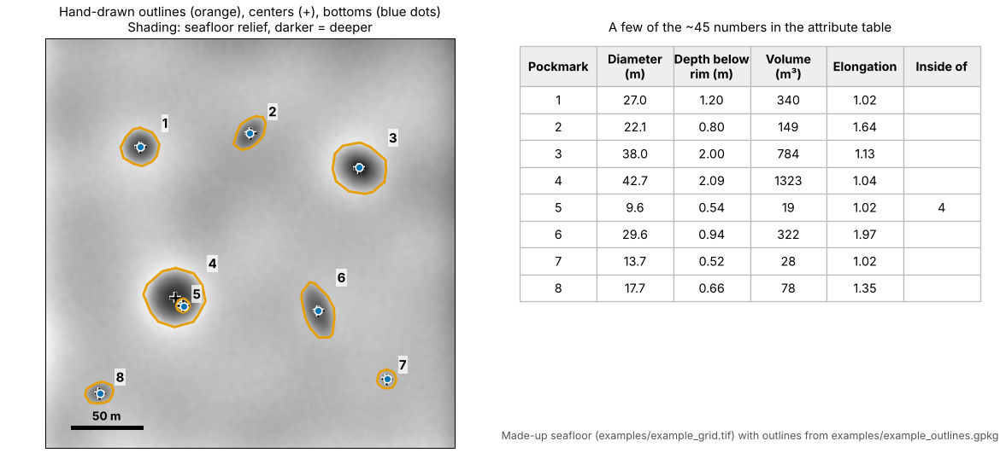

# Pockmark Stats Finder

A QGIS plugin that measures seafloor pockmarks from outlines you draw by hand.

You outline the pockmarks; the plugin does the measuring. Pick your bathymetry grid
and your outline layer, click **Run**, and you get three new layers: your outlines
with about 45 measurements each in the attribute table, the center of each outline,
and the deepest point near each center. Your outline layer is left untouched.

## What it measures

- **Where:** center, deepest point near the center, and how far apart they are
- **Size:** area, perimeter, diameter
- **Depth:** depth below the rim, volume, rim depth, water depth at the bottom
- **Shape:** elongation, long-axis direction, circularity, and whether the pit is
  bowl-shaped or cone-shaped
- **Setting:** seafloor slope and its downhill direction, wall slopes, nearest
  neighbor, and which pockmarks sit inside others
- **Flags:** a note on any outline worth checking (too few grid cells, missing data,
  an outline that crosses itself, and more)

Every column is explained in the [plugin guide](pockmark_stats_finder/README.md).

## Install

1. Download `pockmark_stats_finder.zip` from the latest
   [release](https://github.com/RamonKalski/pockmark-stats-finder/releases).
2. In QGIS, go to **Plugins > Manage and Install Plugins > Install from ZIP**, pick the
   zip (no need to unzip it) and click **Install Plugin**.

Works with QGIS 3.22 and newer. Nothing else to install.

## Try it

The `examples` folder has a small made-up seafloor and eight outlines, so you can see
what the plugin does before using your own data:

1. Drag `examples/example_grid.tif` and `examples/example_outlines.gpkg` into QGIS.
2. Click the plugin's toolbar button, pick the two layers, and click **Run**.

You should get the results shown in the picture above.

## Use it on your own data

1. Load your bathymetry grid (`.asc` or `.tif`) in a projected coordinate system in
   meters, such as UTM. Use the depth grid itself, not a hillshade made from it.
2. Draw one polygon per pockmark in a polygon layer, and save your edits.
3. Run the plugin as above.

## How it works

1. The local seafloor slope is removed using a ring of seafloor just outside each
   outline, so a pit on a slope is measured like a pit on flat ground.
2. The bottom is the deepest point within half the pit's radius of its center.
3. The rim level is the middle depth along your outline.
4. Depth and volume are measured from the rim level down.

## Checking the code

You can check the measurements without QGIS. This runs them on made-up pits whose
true size, depth, volume and direction are known:

    python tests/test_pmcore.py

## How to cite

If you use this tool in your work, please cite it:

> Kalski, R. (2026). *Pockmark Stats Finder: a QGIS plugin for measuring pockmarks
> from hand-drawn outlines* (Version 1.0.0) [Computer software].
> https://doi.org/10.5281/zenodo.24398899

The **Cite this repository** button on this page gives other formats, such as BibTeX.

## How this code was made

Ramon Kalski designed the tool, chose the methods, tested it on multibeam survey data
from the U.S. Mid-Atlantic margin, and maintains it. The code was written with help
from Claude, an AI tool made by Anthropic.

## License

The measuring code (`pmcore.py`) and its tests are under the MIT License, so anyone
can reuse them with credit. The QGIS plugin files are under GPL-2.0-or-later, the same
license as QGIS. See [LICENSE](LICENSE) for details.

## Questions and problems

Please open an [issue](https://github.com/RamonKalski/pockmark-stats-finder/issues).
If something goes wrong, include the red error text from the QGIS log.
